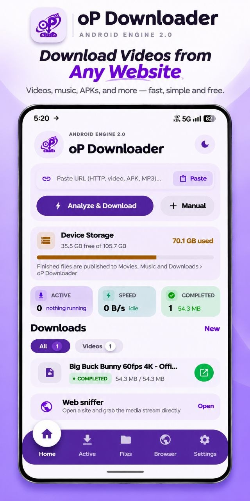
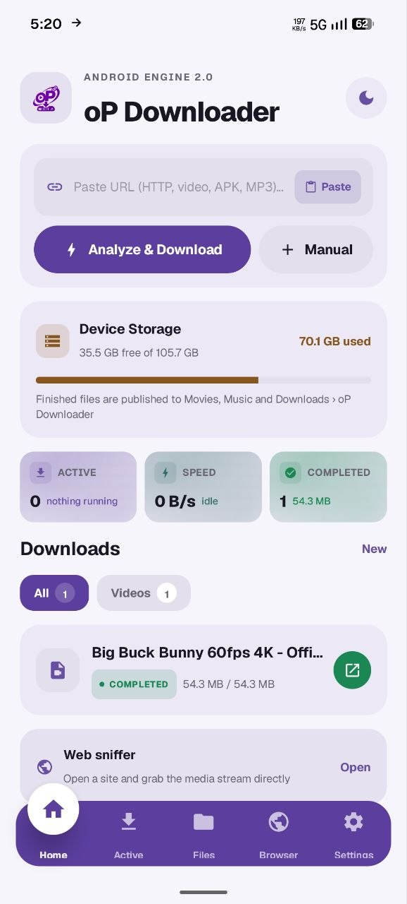
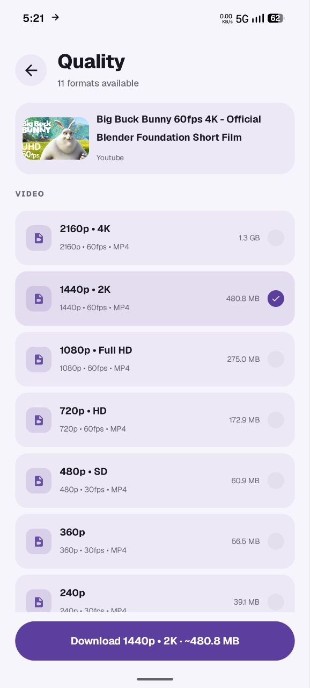
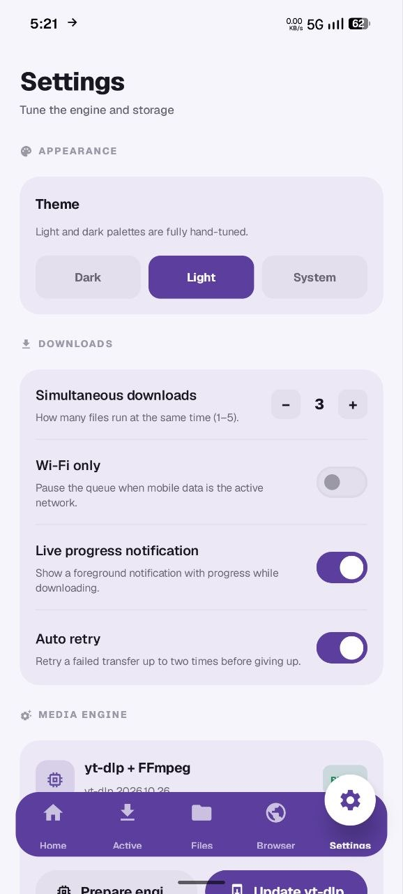
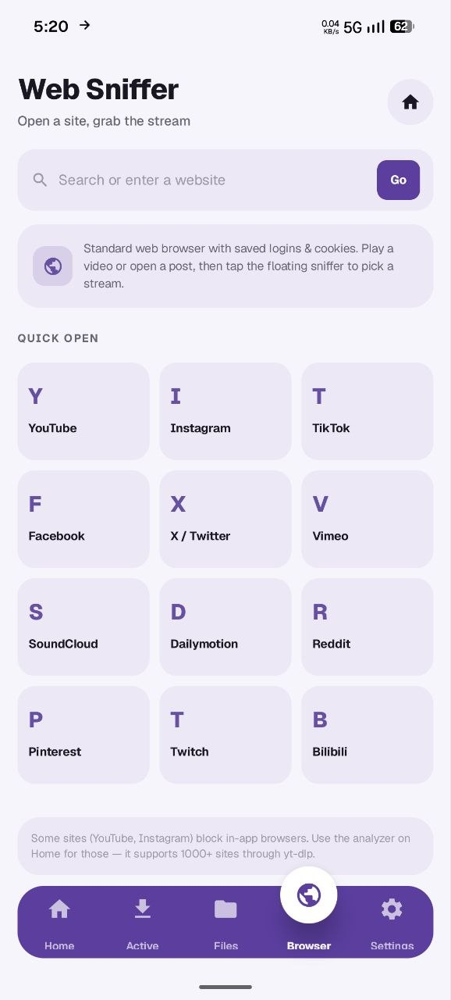

<div align="center">


# oP Downloader

**A fast, private, all-in-one download manager for Android.**

Paste a link or sniff a stream from the built-in browser — oP Downloader handles direct files and 1000+ video sites with real multi-threaded extraction, quality selection, and automatic MediaStore publishing.

[](https://github.com/iamrony27/opdownloader/releases/latest)
[](https://developer.android.com/)
[](#architecture)
[](#how-it-works)
[](LICENSE)

[](https://rookieenough.github.io/Orion-Data/app/?id=opdownloader)

<a href="https://github.com/iamrony27/opdownloader/releases/latest"><strong>⬇️ Download APK</strong></a>
&nbsp;·&nbsp; <a href="#quick-start">Quick start</a>
&nbsp;·&nbsp; <a href="#features">Features</a>
&nbsp;·&nbsp; <a href="#architecture">Architecture</a>

</div>

---

## Screenshots

<table>
  <tr>
    <td align="center"><br><sub>Home</sub></td>
    <td align="center"><br><sub>Active transfers</sub></td>
    <td align="center"><br><sub>Quality selection</sub></td>
    <td align="center"><br><sub>Web Sniffer</sub></td>
    <td align="center"><br><sub>Settings</sub></td>
  </tr>
</table>

---

## Features

| | What you get |
|---|---|
| ⚡ **Two real engines** | Resumable OkHttp range downloads for direct files; bundled Python + yt-dlp + FFmpeg for 1000+ video sites, with merging to MP4/MP3. |
| 🎯 **Quality that matches** | Per-resolution picker shows estimated size. The selected height is enforced at download time — no silent downgrade. |
| 🕵️ **Web Sniffer** | Floating, draggable detector over a full in-app browser. Size-probed results with filters, HLS/DASH support, and auto ad-skip. |
| 🔁 **Resilient transfers** | Pause/resume from `.part` files, auto-retry, restart recovery, Wi-Fi-only mode, configurable concurrency (1–5). |
| 📁 **Clean file output** | Published to public `Movies/oP Downloader`, `Music/oP Downloader`, and `Download/oP Downloader` collections, with a safe app-specific fallback. |
| 🔋 **Built for the background** | Foreground service + live notification, battery-settings shortcut, screen-off continuity. |
| 🎨 **Polished UI** | Compose Material 3, purple `oP` brand mark, Android 12+ splash, adaptive launcher icon, dark/light/system themes. |
| ⭐ **Community-friendly** | GitHub star card, once-after-3-days star prompt, in-app update checker backed by GitHub Releases. |

**Package:** `com.opdownloader.app` · Old installs (`com.premiumdownloader`, `com.premiumdownloader.pro`) stay separate — their history is untouched.

### What's new in 1.2.0

- **Quality and size now agree.** The size shown on a quality option is the size of the exact stream that gets downloaded — no more "16.7 MB" turning into 13 MB.
- **The browser sniffer is easier to use.** Duplicate streams are collapsed, results use plain names instead of raw CDN hosts, and the button says what it does. Tapping a stream opens the right video.
- **Smoother install experience.** The battery-optimization exemption request was removed in favour of a settings shortcut.

---

## Quick start

### Install the signed build

Download `app-release.apk` from the [latest release](https://github.com/iamrony27/opdownloader/releases/latest) and install it:

```bash
adb install -r app-release.apk
```

> The `app-release.apk` in the repository root is the archived v1.1.0 build, kept for reference. Always use the latest release for the current version.

Upgrading over v9/v10 keeps your downloads and history.

### Build from source

Requirements: **JDK 17+**, **Android SDK 36**, device/emulator on **API 26+**.

```bash
./gradlew :app:assembleRelease
adb install -r app/build/outputs/apk/release/app-release.apk
```

> [!IMPORTANT]
> A signed release needs your own `keystore.properties` (next to `build.gradle.kts`) and a `.jks` file. Both are **intentionally gitignored and never published**. Without them, run `:app:assembleDebug` for an unsigned build.
>
> `useLegacyPackaging = true` is **required** so `libpython.zip.so` and FFmpeg binaries can be extracted at runtime — don't remove it.

Dependency versions are pinned for **AGP 8.13.1 / compileSdk 36** (Compose BOM `2025.06.01`, Navigation `2.9.0`, Coil `2.7.0`). Newer BOMs need AGP 9.x + compileSdk 37.

<details>
<summary><b>Wireless ADB</b></summary>

```bash
adb connect <phone-ip>:<port>
adb devices -l
```

If the connection drops, rediscover it with `avahi-browse -rt _adb-tls-connect._tcp`.

</details>

---

## How it works

| Input | Engine | Path |
|---|---|---|
| Direct file URL | **OkHttp** | `DirectDownloader.kt` → `Net.client.newCall()` → HTTP Range resume |
| Video site link | **Python yt-dlp + FFmpeg** | `MediaTools.kt` → `YoutubeDL.getInstance().execute()` → format selection → merge |
| Sniffed stream | **yt-dlp** (or direct OkHttp) | WebView detects media → analyzer → quality picker → download |

Analysis runs once with `yt-dlp --dump-single-json` and is cached for 2 hours (`cacheDir/yt_info/<sha256>.json`). Downloads reuse it via `--load-info-json`, so pressing **Download** starts immediately instead of re-parsing the page. A stale/expired cache is deleted and retried with a fresh extraction.

Some streaming sites sign their HLS URLs with short-lived tokens — the chosen quality height is stored with the item and the page is re-read at download start to swap in a fresh URL for the same resolution.

<details>
<summary><b>Progress, pause & restart internals</b></summary>

- Raw `[download]` lines are parsed in-app (the bundled library's legacy regex misses current yt-dlp output), and `cacheDir/ytdlp_<id>` is polled every 450 ms for real byte growth. This keeps speed/ETA/bars moving even through merged video+audio jobs where yt-dlp resets its percentage.
- Pausing calls `YoutubeDL.destroyProcessById`; resume reuses the same cache dir with `--continue`.
- On process start, any `QUEUED`/`DOWNLOADING` item becomes `PAUSED` ("Interrupted by app restart") so a killed process can't leave a ghost job.
- HLS downloads use bundled FFmpeg (`--hls-prefer-ffmpeg`) and send the origin site's `Referer` header when a CDN requires it.
- MediaStore rejects `application/octet-stream` on API 37 — the publisher falls back to `/sdcard/Android/data/com.opdownloader.app/files/Download/oP Downloader/`.

</details>

---

## Web Sniffer

The **Browser** tab is a real in-app browser with persistent cookies/logins, back/reload, address bar, and a **fullscreen mode** (expand icon) that hides the tab bar for maximum page height.

- The sniffer pill floats above the floating tab bar and system navigation, stays draggable within the visible browser area, and clamps to bounds.
- Candidates are de-duplicated and byte-probed (`HEAD`, then a 1-byte ranged `GET` when a CDN rejects `HEAD`). Files under **150 KB** are hidden as thumbnails/ad bumps.
- Picker shows title, host, quality, and size with **All / > 1 MB / > 5 MB / > 20 MB** filters. HLS/DASH manifests and watch pages are always kept.
- Watch-page detection covers YouTube (incl. Shorts), Instagram, TikTok, X/Twitter, Vimeo, Dailymotion and common embed hosts.
- **Auto-skip ads** clicks Skip/Close controls and, during HTML5 ad reels, mutes + raises playback to 16× until the ad clears — it never seeks the video.

<details>
<summary><b>When the analyzer is blocked by server-side fingerprinting</b></summary>

Some extractors are fingerprinted server-side — the site's page endpoint answers yt-dlp with **HTTP 403** while a normal browser session loads fine. Use the sniffer instead:

1. Browser tab → open the video page → wait for media chips.
2. Tap the chip for the **full VOD** stream (the site's `master.m3u8`, or a 720P `index-v1-a1.m3u8` variant).
3. Avoid `edge-hls...` playlists starting at a non-zero `#EXT-X-MEDIA-SEQUENCE` — those are short live-edge windows.
4. Analyze → choose quality → download. Verified: a 13:16 video → 77 MB 480p H.264/AAC MP4.

</details>

---

## First run (automatic)

1. Native Android 12+ splash → animated Compose splash with the `oP` logo.
2. Onboarding slides (first install only) → notification permission + battery-exemption dialog. Change later in **Settings → Downloads → Run in background**.
3. **Automatic engine setup** — unpacks Python/FFmpeg, then pulls the current STABLE yt-dlp. Failures retry once, then offer **Retry setup**.
4. Persists `engineSetupDone = true` and enters Home. Later launches go straight to Home.

Manual recovery stays available in **Settings → Media engine**. If the update can't finish but the runtime prepared, "Continue with the bundled engine" is offered (the flag isn't persisted, so it retries next launch).

---

## Architecture

```
app/src/main/java/com/opdownloader/app/
├── data/         models, persisted store, star-prompt state
├── engine/       DirectDownloader · MediaTools · DownloadManager
│                 FilePublisher · UpdateChecker · NotificationHelper · Net
├── service/      foreground DownloadService
└── ui/           PremiumApp nav host + floating tab bar
    ├── components/  shared cards, update & background rows
    ├── screens/     Home · Active · Files · Browser · Settings ·
    │                Analyzer · Quality · Details · About · Setup
    └── theme/       Material 3 theme
```

<details>
<summary><b>Verified on device — 2026-11-17</b></summary>

Tested on an Android 15 / API 37 arm64 device over wireless adb:

- Direct resumable `sample-5s.mp4` → correct `Movies/oP Downloader` MediaStore row.
- Document path → `Download/oP Downloader`; audio MP3 → `Music/oP Downloader` (19 MB).
- yt-dlp analysis: 11 formats with thumbnail, title, duration and per-format sizes.
- 1080p DASH (148 MB merged) and 720p merged DASH (97.5 MB) with live speed/ETA; 480p estimate corrected from 60.9 → 54.1 MB when audio started.
- **Pause/resume of a yt-dlp job**: paused at ~30 MB, resumed from `.part` (30.3 → 41.8 MB) and completed.
- **HLS VOD via Web Sniffer**: 72 segments → 13:16 / 77 MB 480p MP4, checked with `ffprobe`.
- Restart recovery, quality picker, notification `download_progress`, share-sheet intake, Details screen, dual delete choices.
- Branding verified with `aapt2 dump badging`; adaptive icon + legacy/round mipmaps mdpi–xxxhdpi.
- Star prompt, update checker, missing-file badge, background permission row.
- Fast analyze → download hand-off: cold analysis `15.2 s`, cached re-analysis `27 ms`, engine start `2.2 s` vs `15.2 s`.

</details>

---

## Community & updates

- **Settings → Community → Star oP Downloader on GitHub ⭐** opens this repo; the same card links to the issue tracker.
- After **three days of use**, a one-time "Enjoying oP Downloader?" dialog offers **Star / Later / Don't ask again**. "Later" snoozes 7 days; opting out is permanent. Main tabs only.
- **Check for updates** (Settings → About) calls GitHub's `releases/latest` API, compares dotted versions, and opens the release page. Network failures offer **Retry**.
- **Missing files**: a completed entry whose file was deleted shows **FILE DELETED** and "File no longer on device". History is never auto-removed; both delete choices are untouched.

---

## Known limitations

| Limitation | Workaround / status |
|---|---|
| TLS fingerprinting blocks paste-field analysis on some sites | Use the Web Sniffer flow above; `curl_cffi` impersonation is planned |
| Private / age-restricted YouTube | Needs exported cookies (`--cookies`) — not wired into the UI yet |
| DRM-protected streams | Out of scope for an in-app WebView |
| Unknown MIME types | Fall back to the app-specific folder (accessible in-app) |
| No torrent/magnet support | FetchJet torrent engine not ported |
| CI signing not configured | Sign locally with an uncommitted keystore |

<details>
<summary><b>Roadmap</b></summary>

1. Signed-release CI via GitHub Actions with secret-backed keystore
2. Encrypted cookies import for private videos and age gates
3. Torrent support (FetchJet / libtorrent4j)
4. Per-item scheduling, speed caps, battery-aware pause
5. Embedded thumbnails/subtitles + subtitle picker
6. Content-sniffed MIME detection in MediaStore
7. WorkManager fallback for long queued jobs
8. Unit + instrumented tests for publisher and queue state machine

</details>

---

<div align="center">

Built with Kotlin, Jetpack Compose, OkHttp, yt-dlp and FFmpeg.

Licensed under the [MIT License](LICENSE).

<a href="https://github.com/iamrony27/opdownloader/releases/latest"><strong>Get the latest APK →</strong></a>

</div>
